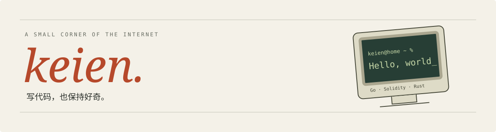
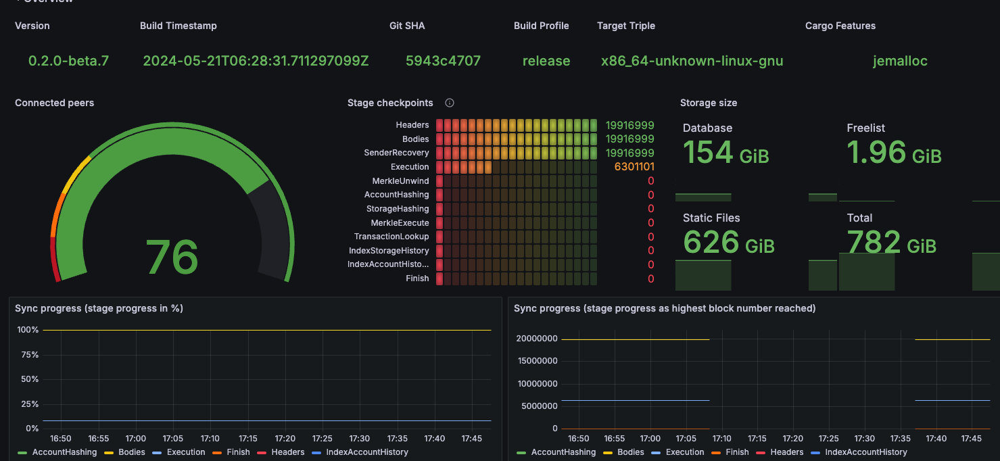
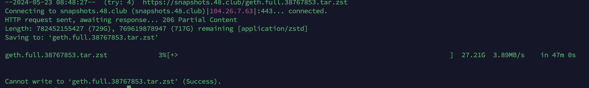
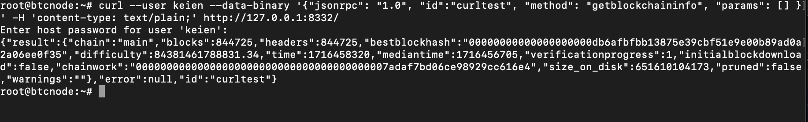
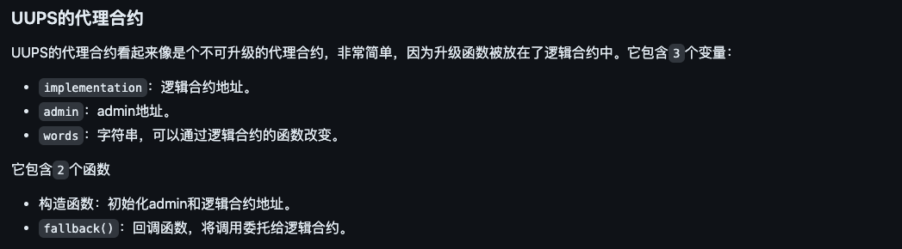

[项目选读](#项目选读) · [在其他地方找到我](#在其他地方找到我) · [个人主页源码](index.html) · [本地预览说明](HOMEPAGE.md)

# 你好，我是 keien 👋

Blockchain developer | Go, Solidity & Rust | Building tools for nodes, EVM and Solana.

我的开发经历涵盖公链、EVM / Solana 智能合约和后端服务。我喜欢从实际开发问题出发，整理节点操作、链上交互和监控工具。

## 技术方向

Go、Solidity、Rust、TypeScript / JavaScript。

## 项目选读

- [getEthPubNode](https://github.com/keienWang/getEthPubNode)：以太坊节点信息获取与 RPC 示例。
- [ao-monitoing-service](https://github.com/keienWang/ao-monitoing-service)：AO 合约状态监控与邮件提醒。
- [scihub_lock_sol](https://github.com/keienWang/scihub_lock_sol)：基于 Anchor 的 Solana 合约及测试。

## 在其他地方找到我

[Twitter](https://twitter.com/Happyporter4) · [CSDN](https://blog.csdn.net/The_Reader)

生活与阅读

热爱编程、唱、跳、rap、篮球。

热爱计算机科学和 IT 互联网事业，希望能成为一名优秀的开发者。

很喜欢的一句话是：这个时代唯一不变的就是变。无论何时，我们都应保持自我更新的能力，即便不能走到时代的最前列，也不能任由自己被时代抛弃，人只有不断更新自己，才能与时代的不确定性共舞。

以下保留原主页的阅读、观影和音乐记录：

<!-- START_SECTION:douban -->
- [读过《认知觉醒》](https://book.douban.com/subject/35193035/) 🌟🌟🌟🌟🌟 力荐 · 2024-01-10
- [在读《极简主义》](https://book.douban.com/subject/27040433/) 🌟🌟🌟🌟🌟 力荐 · 2023-11-11
- [看过《肖申克的救赎》](https://movie.douban.com/subject/1292052/) 🌟🌟🌟🌟🌟 力荐 · 2023-02-08
- [看过《活着》](https://movie.douban.com/subject/1292365/) 🌟🌟🌟🌟 力荐 · 2023-02-07
- [听过《假如爱有天意》](https://music.douban.com/subject/26567580/) 🌟🌟🌟🌟🌟 力荐 · 2023-02-02
<!-- END_SECTION:douban -->

节点与学习记录

以下是原主页的开发记录与截图，保留作历史记录，不代表当前节点状态或硬件需求。

### reth 节点

原记录：正在搭建 reth 节点，已同步至最新，空间占用才 2T，速度很快，只不过必须要 SSD 才可以，机械硬盘根本追不上最新区块。

### BSC 节点

原记录：正在下载 BSC 节点快照，公司网络有问题，已反馈，并切换网络。

### BTC 节点

原记录：正在跟上 BTC 节点的最新区块，可配置 user 与 password，RPC 一直可用。

### Solidity 学习

原记录：巩固 Solidity 基础知识。

